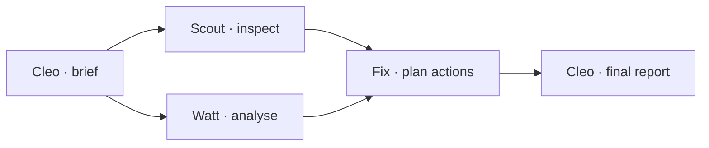

<div align="center">

# Caretakr

### A tiny AI team. A whole apartment to care for.

Turn property evidence into prioritised maintenance actions—then watch the team work inside an interactive 3D apartment.

**Grok Bot Real Estate Hackathon London · Track 4: Asset and property management**

[Try the demo](#try-it-in-60-seconds) · [Meet the team](#four-specialists-one-shared-mission) · [Grok Bot integration](docs/grok-integration.md)


</div>

## From “something looks wrong” to “here’s what to do”

Walkthrough notes, meter readings and maintenance decisions belong in one connected workflow. Caretakr gives each specialist a job, ties findings to their sources and turns the results into a plan a property manager can act on.

| 🏠 See the work | 🔎 Follow the evidence | 🛠 Leave with a plan |
| :--- | :--- | :--- |
| Orbit a five-room 3D twin. Follow agents, focus rooms and open finding markers. | Inspect source evidence, timestamped activity and specialist handoffs. | Review priorities, work orders and a health score. Export HTML or JSON. |

## Four specialists. One shared mission.

| Agent | Owns | Hands off |
| :--- | :--- | :--- |
| 🔵 **Scout** · Inspector | Walkthrough evidence | Sourced apparent defects |
| 🟣 **Watt** · Energy Analyst | Consumption and occupancy | Energy anomalies |
| 🟠 **Fix** · Maintenance Engineer | Published specialist findings | Prioritised work orders |
| 🟢 **Cleo** · Property Manager | Brief and coordination | Final sourced plan |



## Try it in 60 seconds

Requires **Node.js 22.13+** and a browser with WebGL.

```sh
npm install
npm run grok:setup
npm run dev
```

Open [localhost:3000](http://localhost:3000), keep **Demo** selected and click **Inspect property**. No Grok Bot account needed.

**Judge’s walkthrough:** follow an agent → open a finding → inspect its evidence → open the completed report → download the action plan. Use **4×** playback for a quick tour.

| 💧 Bathroom | ⚡ Kitchen | 🚪 Hallway |
| :--- | :--- | :--- |
| Suspected ceiling moisture | **4.8 kWh** vs **1.2 kWh** baseline | Potentially obstructed escape route |
| Investigate the source | **300% above baseline** | Clear and measure access |

*Demo uses synthetic evidence: 3 findings → 3 work orders → an illustrative 62/100 score. The original procedural apartment represents evidence review, not physical robotic inspection or a certified safety assessment.*

## Real Grok Bot teammates. Visible handoffs.

**Demo** runs a deterministic backend scenario. **Live** dispatches real tasks to Grok Bot teammates through a pinned, unofficial SDK, validates their replies and streams workflow events into the scene. Live errors stay visible.

The [verified Live run](docs/grok-integration.md#verified-full-four-bot-inspection) completed with **4 Bots · 3 sourced findings · 3 work orders · 68 timestamped events**. Its score was **76/100**, calculated from the live findings; Live outputs can differ from Demo.

**Custom MCP tools** let connected Bots read evidence, publish findings, create work orders and complete inspections. SDK replies and actual MCP calls are distinguished in the event stream. [Connect your Bots →](docs/grok-integration.md)

<div align="center">

**Next.js 16 · React 19 · React Three Fiber · Three.js · Zustand · Zod**

Node backend → validated events → SSE → interactive 3D scene

</div>

## Under the hood

[Setup, architecture & checks](docs/technical-guide.md) · [Live integration & security](docs/grok-integration.md) · [Environment settings](.env.example) · [Attribution](docs/reference-patterns.md) · [License](LICENSE)

Run one persistent Node process; inspection state is held in memory. Keep `.env.local` and `.caretakr/` private. Grok credentials stay on the server.
